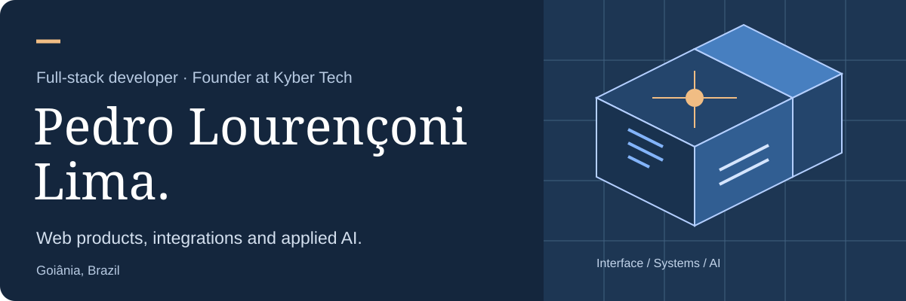

  <a href="https://www.pedrolou.dev"><strong>Portfolio</strong></a> &nbsp; / &nbsp;
  <a href="#selected-work">Selected work</a> &nbsp; / &nbsp;
  <a href="#public-code">Public code</a> &nbsp; / &nbsp;
  <a href="https://www.linkedin.com/in/pedrolourenconilima/">LinkedIn</a> &nbsp; / &nbsp;
  <a href="mailto:pedroloulima@gmail.com">Email</a>

## Hi, I'm Pedro.

I'm a full-stack developer from Goiânia, Brazil, and the founder of **[Kyber Tech](https://somoskyber.com.br)**. I build web products, connect systems and apply AI to practical problems.

My work spans the interface, the API and the operation behind them: education software at **Didata**, business workflows at **Kyber**, and developer tools I build to make everyday work easier.

For the story behind the code, visit **[my portfolio](https://www.pedrolou.dev)** — available in Portuguese and English.

## Selected work

### [Didata](https://usedidata.com.br)
AI-assisted tools for teachers: lesson planning, activities, exams and photo-based assessment workflows. Teachers review the output; for written answers, AI transcribes and the teacher assigns the grade.

**Next.js · TypeScript · Prisma · AI**
[Try the product](https://usedidata.com.br) · [Read the case study](https://www.pedrolou.dev/projetos/didata)

### [Kyber CRM](https://www.pedrolou.dev/projetos/kyber-crm)
An internal platform connecting sales, proposals, delivery and finance. Its MCP server lets AI tools work with the same business workflows through conversation.

**Next.js · PostgreSQL · Supabase · MCP**
[Read the case study](https://www.pedrolou.dev/projetos/kyber-crm) · Private source

### [Brava.gg](https://www.pedrolou.dev/projetos/brava)
A team-built FiveM roleplay project connecting a game server to the web. My work includes the dashboard, API and integrations for players, economy and operational alerts.

**React · TypeScript · Lua · MariaDB**
[Read the case study](https://www.pedrolou.dev/projetos/brava) · Private source

## Public code

| Project | What you'll find |
| :--- | :--- |
| [Codex Dictation](https://github.com/PedroLLou/codex-dictation) | Experimental Windows voice dictation companion for T3 Code, with Portuguese and English UI. |
| [Humanizador](https://github.com/PedroLLou/humanizador) | An agent skill for revising AI-sounding Portuguese while preserving meaning and the writer's voice. |
| [Pulso](https://github.com/PedroLLou/pulso) | Academic mobile project for managing freelance clients, projects, support and renewal dates. Built with React Native and Expo. |
| [Skills Management](https://github.com/PedroLLou/tcc20261) | Graduation project for managing and evaluating software professionals' competencies. |
| [Criptolib](https://github.com/PedroLLou/criptografia-aplicada-atividade4) | Academic Python library exploring modular arithmetic and number theory. |

## What I work with

| Area | Tools & technologies |
| :--- | :--- |
| Interfaces | TypeScript, JavaScript, React, Next.js, Tailwind CSS |
| APIs & data | Node.js, Python, PostgreSQL, Supabase, Prisma |
| Applied AI | OpenAI, Anthropic, RAG, vision, MCP |
| Delivery | Git, GitHub, Vitest, Playwright, CI/CD, Vercel |
| Beyond the web | Lua, FiveM, React Native, Expo |

---

**Have a project or opportunity in mind?**
[Email me](mailto:pedroloulima@gmail.com) · [Connect on LinkedIn](https://www.linkedin.com/in/pedrolourenconilima/) · [Explore Kyber Tech](https://somoskyber.com.br)
